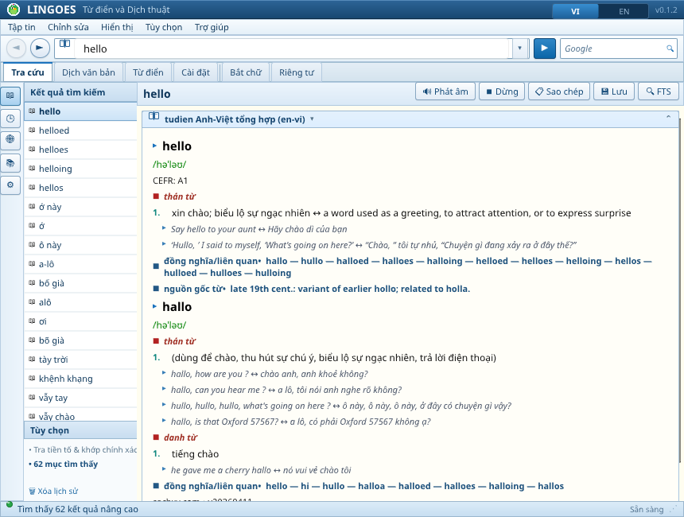
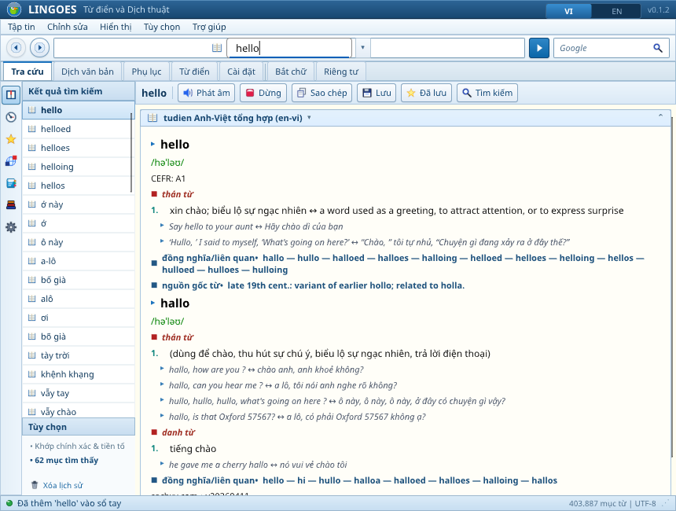
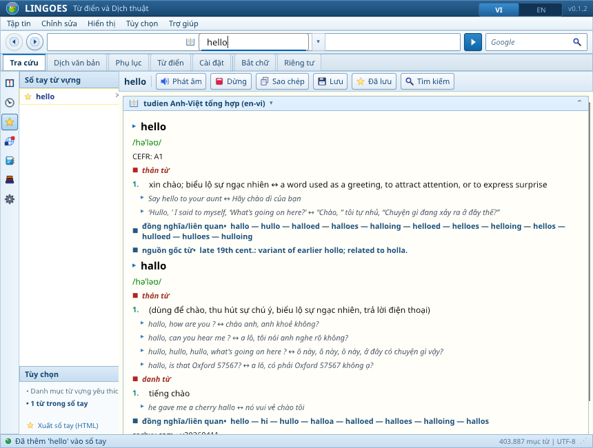
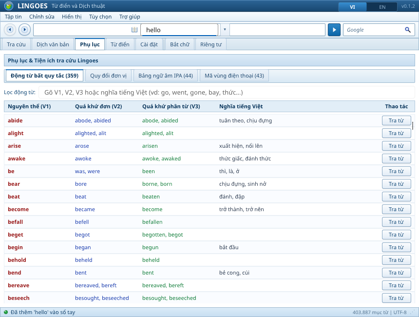
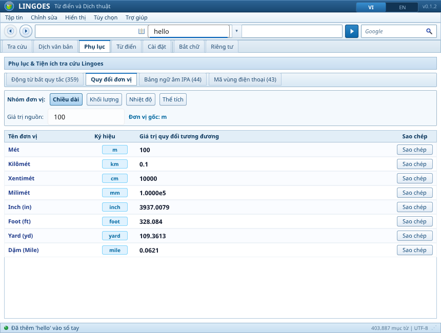
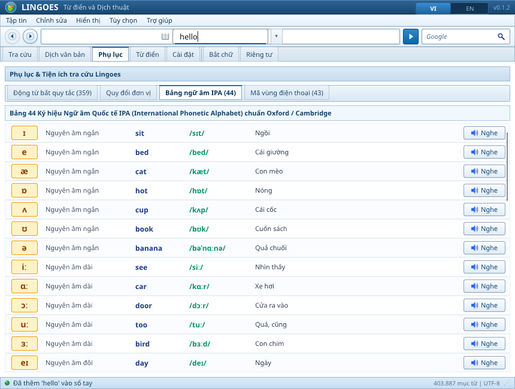
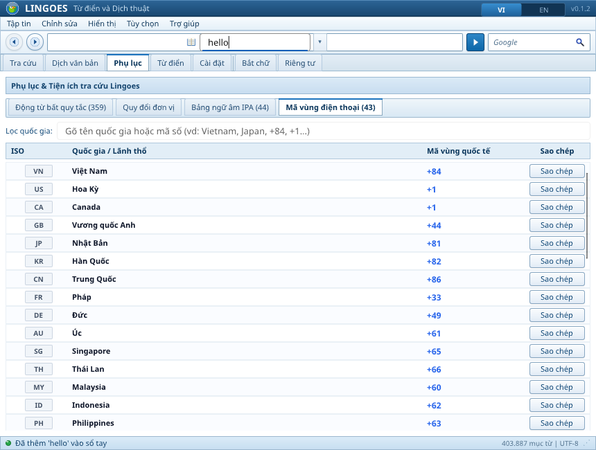
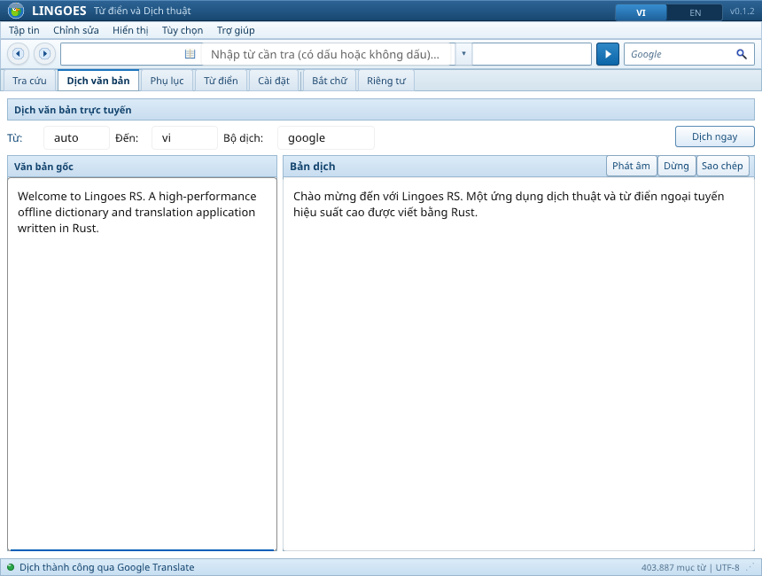
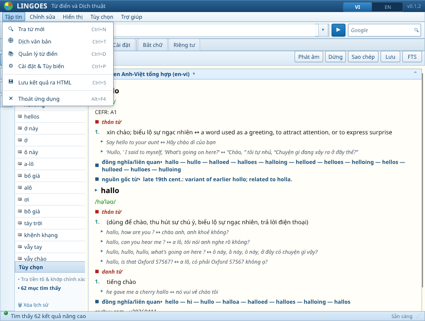

# Lingoes RS

A clean-room, Rust-only dictionary, translation, text capture, and text-to-speech desktop application inspired by the useful workflows of classic Lingoes.


## Latest UI Gallery

### Main dictionary window & Start Page
Classic Lingoes 2.9.2 Win32 Aero layout with quick-action shortcuts, dynamic status bar displaying active entries (`403.887 mục từ | UTF-8`), and navigation rail.



### Detailed bilingual dictionary result with Action Bar
Rich definitions with phonetic IPA, part-of-speech tags, structured senses, examples, and one-click Word Notebook star toggle (`act_star.png`).



### Word Notebook (Sổ tay từ vựng)
Personal vocabulary notebook with one-click star tagging, quick delete (`×`), and full HTML export (`Ctrl+S` / `Export HTML`).



### Appendices — 359 English Irregular Verbs
Searchable 359 irregular verb table with past tense, past participle, -ing forms, Vietnamese definitions, and instant Click-to-Lookup.



### Appendices — 2-Way Interactive Unit Converter
Real-time bi-directional conversion across Length, Weight, Temperature, and Volume metrics with live calculation tables.



### Appendices — International Phonetic Alphabet (IPA) Chart
Comprehensive 44-phoneme IPA chart categorized into monophthongs, diphthongs, and consonants with word examples and listen actions.



### Appendices — International Dialing Codes
Complete 43+ country international calling code directory with ISO badges, country names, prefix codes, and one-click clipboard copy.



### Online Text Translation
Multi-line dual-pane translation engine supporting Google Translate and OpenAI/Local LLMs with automatic word-wrap and text-to-speech audio.



### Classic Win32 Dropdown Menus
Pixel-perfect classic Win32 hierarchical menu bar with keyboard accelerators (`Ctrl+N`, `Ctrl+W`, `Ctrl+A`, `Ctrl+T`, `Ctrl+D`, `Ctrl+S`, `Alt+F4`).



## Principles

- **Pure Rust**: 100% Rust architecture across domain logic, database engines, parsers, capture systems, and GUI (no C# or .NET runtime dependencies).
- **Offline-First**: High-performance local SQLite dictionary engine with BM25 full-text search (FTS5) and sub-millisecond prefix lookups.
- **Online Translation & Local AI**: Built-in translation pipeline supporting Google Translate as well as OpenAI / Local LLM APIs (Ollama, LM Studio, vLLM).
- **Multi-Format Support**: Direct import support for UTF-8 TSV, StarDict (`.ifo`, `.idx`, `.dict`, `.dict.dz`), and MDict MDX v2.0.
- **Background Text Capture**: Seamless clipboard capture with configurable debouncing, length bounds, and instant quick popup lookup.
- **Cross-Platform Delivery**: Runs on Linux and Windows; designed with portable data layout (`data/lingoes.db` alongside binary).

---

## Workspace Architecture

```
lingoes-rs/
├── crates/
│   ├── lingoes-core         # Core domain types (DictionaryEntry, LookupQuery, Unicode NFC normalization)
│   ├── lingoes-dictionary   # SQLite store, FTS5 indexes, schema migrations, and dictionary importers
│   ├── lingoes-translator   # Translation traits, Google Translate and OpenAI/Local LLM clients
│   ├── lingoes-tts          # Text-to-speech traits, system command backends (spd-say, espeak, say, powershell)
│   └── lingoes-capture      # Background clipboard monitoring, debounce filtering, and mock readers
├── apps/
│   └── lingoes-desktop      # Slint 1.8.0 native desktop application and CLI command suite
└── docs/plans               # Engineering blueprints and implementation milestones
```

### Crate Responsibilities

1. **`lingoes-core`**:
   - `DictionaryEntry`: Headword, definition, and dictionary attribution metadata.
   - `LookupQuery`: Normalization rules (Unicode NFC canonicalization, lowercase folding, whitespace trimming).

2. **`lingoes-dictionary`**:
   - SQLite persistent storage with WAL mode and foreign key constraints.
   - FTS5 full-text index with BM25 ranking.
   - Importers:
     - Tab-separated values (`headword\tdefinition`).
     - StarDict index and dictionary files (including DictZip decompression).
     - Pure-Rust MDict MDX v2 parser via `opendict-rs`.
   - Multi-dictionary management: enable/disable toggles, deletion, and isolated dictionary attribution.

3. **`lingoes-translator`**:
   - Asynchronous translation trait `Translator`.
   - `GoogleTranslator`: Direct Google Translate client with sentence chunking.
   - `OpenAiTranslator`: Compatible with OpenAI Chat Completions API and local LLM endpoints (Ollama, vLLM, LM Studio).
   - `MockTranslator`: Deterministic mock translator for tests and offline builds.

4. **`lingoes-tts`**:
   - Audio synthesis trait `TtsEngine`.
   - `SystemTtsEngine`: Dynamic probe and fallback across system commands (`spd-say`, `espeak-ng`, `espeak`, macOS `say`, Windows PowerShell SAPI).
   - `MockTtsEngine`: Deterministic mock TTS engine for headless test suites.

5. **`lingoes-capture`**:
   - `ClipboardReader`: Cross-platform clipboard abstraction (`SystemClipboardReader` via `arboard`, `MockClipboardReader`).
   - `ClipboardWatcher`: Background thread watcher with duplicate debouncing, min/max length filtering, and whitespace trimming.

6. **`lingoes-desktop`**:
   - Slint 1.8.0 user interface with 3 main tabs:
     - **Tra cứu** (Dictionary Lookup): Real-time search, FTS5 full-text search, detail view, TTS pronunciation, copy to clipboard.
     - **Dịch trực tuyến** (Online Translation): Multi-line source/target text, language selection, engine selection (Google / Local LLM), translation status.
     - **Quản lý từ điển** (Dictionary Manager): Dictionary listing table, toggle enable/disable, delete dictionary, custom import form.
     - **Cài đặt & Bắt chữ**: Clipboard auto-capture toggle, Local AI / OpenAI endpoint configuration (`http://localhost:20128/v1`), model selector.
     - **Quick Popup Card**: Floating preview card displaying captured word definitions.
   - Dual-mode executable: Launches GUI when run without arguments, or executes CLI subcommands when arguments are provided.

---

## Desktop UI Features

- **Tab 1: Tra cứu (Dictionary Lookup)**
  - Instant prefix lookup as you type.
  - "Tìm toàn văn" (Full-Text Search) button for matching definitions across installed dictionaries.
  - Detail pane showing headword, source dictionary badge, formatted definition.
  - "🔊 Phát âm" (TTS) button to hear native pronunciation.
  - "📋 Sao chép" button to copy definition text.
- **Tab 2: Dịch trực tuyến (Online Translation)**
  - Source text editor with multi-line input.
  - Source language (Auto, Tiếng Anh, Tiếng Việt, Tiếng Pháp, Tiếng Đức, Tiếng Nhật, Tiếng Trung) and Target language selector buttons.
  - Translation engine selection: **Google Translate** or **Local AI / OpenAI**.
  - Target translated text editor with pronunciation and copy buttons.
- **Tab 3: Quản lý từ điển (Dictionary Manager)**
  - Table of installed dictionaries: ID, Name, Format, Entry count, and Enabled status.
  - One-click buttons to toggle dictionaries on/off or delete them.
  - Import form: Input file path and optional custom dictionary name.
- **Clipboard Monitoring & Quick Popup Card**
  - Checkbox "Bắt chữ tự động khi sao chép" in the header.
  - When copying words anywhere in your OS, Lingoes RS captures the text, performs an instant lookup, and shows the floating Quick Popup Card.

---

## CLI Automation Reference

All features are fully operable from the terminal:

```bash
# 1. Import dictionary (TSV, StarDict .ifo/.idx, or MDict .mdx)
lingoes-desktop import <database.db> <source_path> [--name <dictionary_name>]

# 2. Prefix lookup
lingoes-desktop lookup <database.db> <query>

# 3. Full-text search (SQLite FTS5)
lingoes-desktop full-text <database.db> <query>

# 4. List installed dictionaries
lingoes-desktop list-dictionaries <database.db>

# 5. Enable or disable a dictionary
lingoes-desktop toggle-dictionary <database.db> <id> <true|false>

# 6. Delete a dictionary
lingoes-desktop delete-dictionary <database.db> <id>

# 7. Online text translation
lingoes-desktop translate "Hello world" --from en --to vi --engine google

# 8. Text-to-speech pronunciation
lingoes-desktop tts "Good morning" --lang en

# 9. Launch Graphical Application
lingoes-desktop
```

---

## Building and Verification

### Prerequisites

- Rust 1.85+ (Edition 2024)
- Platform development libraries (for Slint/X11/Wayland):
  - Ubuntu/Debian: `libxkbcommon-dev`, `libfontconfig1-dev`, `libasound2-dev`

### Running the Test Suite

```bash
# Run all 72 unit tests across workspace crates
cargo test --workspace

# Check formatting
cargo fmt --all -- --check

# Check lints with strict warnings denial
cargo clippy --workspace --all-targets -- -D warnings

# Build all workspace binaries
cargo build --workspace
```

### Running GUI Headlessly (CI / Linux Servers)

```bash
xvfb-run target/debug/lingoes-desktop
```

---

## Windows 11 / 10 Standalone Portable & Self-Diagnosis

Lingoes RS compiles to a completely standalone native Windows x64 binary (`lingoes-desktop.exe`):
- **Zero External Runtime Dependencies**: Statically linked CRT (`+crt-static`), zero Microsoft Visual C++ Redistributable requirements.
- **Embedded Win32 Resources**: Native multi-resolution Aero parrot icon (`lingoes.ico`) and Windows 11 Application Manifest (`PerMonitorV2` High-DPI scaling, ComCtl32 v6.0, UTF-8 Code Page, LongPathAware).
- **Self-Diagnosis & Startup Recovery**:
  - Automatically captures parent console (`AttachConsole`) when run from CMD or PowerShell.
  - Automatically writes detailed startup diagnostic logs to `lingoes_startup.log`.
  - Prompts with native Win32 `MessageBoxW` if run unextracted from inside a ZIP archive without `data/lexiforge.db`.
  - Built-in software-renderer fallback (`--software` flag or `SLINT_BACKEND=winit-software`) for machines without dedicated GPU/OpenGL drivers.

### Cross-compiling for Windows x64

```bash
# Cross-compile standalone MSVC release with static CRT
RUSTFLAGS="-C target-feature=+crt-static" cargo xwin build --release --target x86_64-pc-windows-msvc -p lingoes-desktop
```

